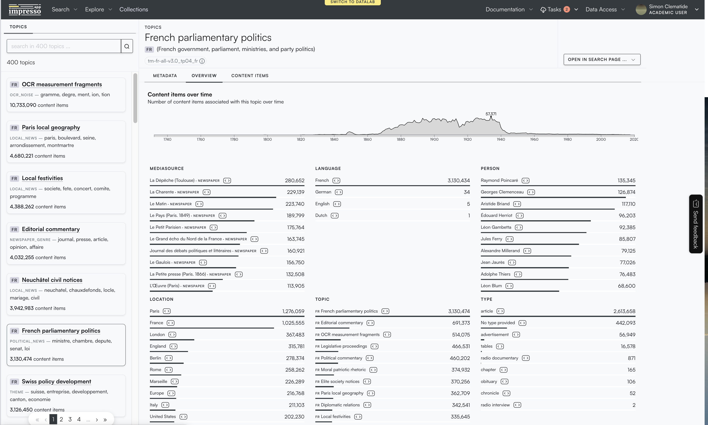
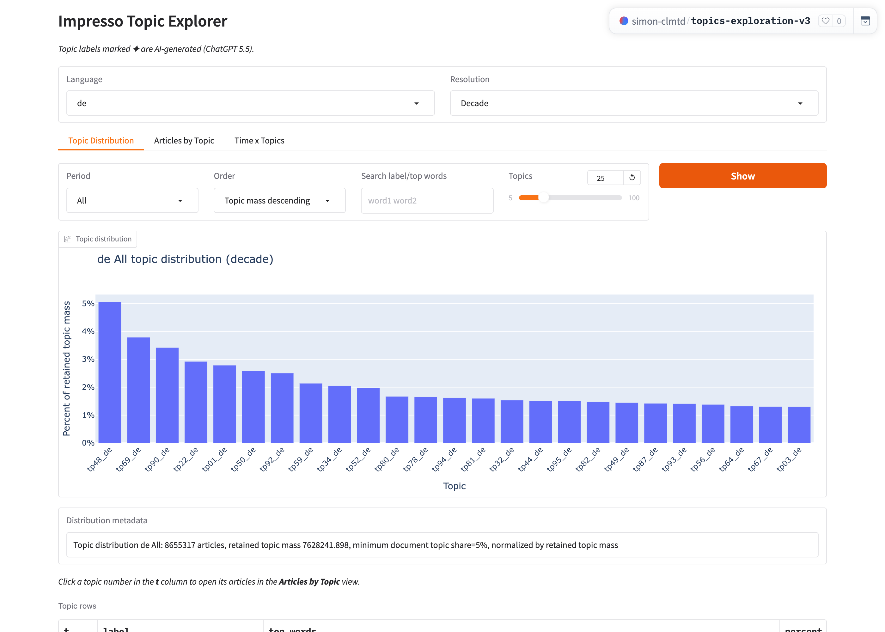
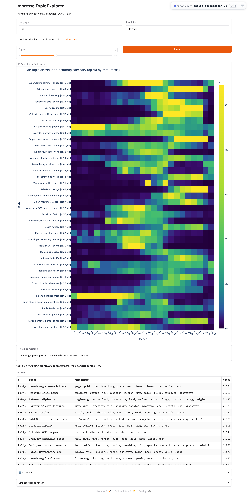
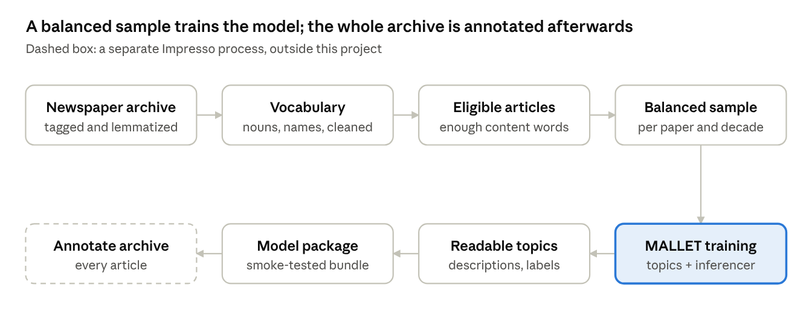

# Topic Modeling Historical Newspapers in Impresso

*An overview for digital humanists.*

## Why topic modeling

Topic modeling gives historians a map of what millions of newspaper articles talk about, without anyone reading them all. The Impresso archive holds over two centuries of Swiss and Luxembourgish newspapers in French, German, Luxembourgish and English. Keyword search only finds what you already know to look for. A topic model instead proposes recurring themes, such as elections, weather, stock prices or church life, and estimates how much of each article belongs to each theme.

This project builds those topic models. It prepares the texts, trains one model per language, makes the topics readable, and hands the finished model to a separate process that annotates every article in the archive. The topics you see in the Impresso interface come from models built here.

## What the topics look like

In the [Impresso web app](https://dev.impresso-project.ch/app/topics/tm-en-all-v3.0_tp34_en/metadata), every topic has its own page. The example below is the French topic *French parliamentary politics*, labeled as political news, with top words *ministre, chambre, député, sénat, loi*. It is linked to about 3.1 million articles. Its curve peaks just before 1940, and the page breaks the articles down by newspaper, person, place and related topic. Raymond Poincaré and Georges Clemenceau are the most frequent people.

The [Impresso Topic Explorer](https://huggingface.co/spaces/simon-clmtd/topics-exploration-v3) on Hugging Face is a more technical view, meant for checking the models across a whole language. The first view ranks topics by their share of the whole collection. For German, *Luxembourg commercial ads* leads at about 5%.

The *Time x Topics* view shows how each topic's share changes by decade. *Cold War international news* appears from the 1950s, and *Television listings* from the 1970s. Topics such as *Syllabic OCR fragments* or *Fraktur OCR debris* show that the model also picks up recognition errors and old typefaces, which are concentrated in early decades.

## How a model is built

Each model passes through eight stages, from the tagged archive to a package that annotates every article.

The stages are described one by one below.

### From articles to words

The model never sees sentences. It only sees which content words each article contains, as an unordered "bag of words". Preparing that bag is where most of the interpretive choices are made.

1. **Linguistic processing.** An earlier Impresso step tags every word with its part of speech (noun, verb, proper name…) and reduces it to its dictionary form, the *lemma*. So *élections*, *élection* and *Elections* all count as one word.
2. **Keeping content words.** Only selected parts of speech are kept, typically nouns and proper names. Articles, prepositions and pronouns carry little thematic meaning and would drown out the signal.
3. **Building a vocabulary.** Each language gets a fixed list of words the model may use. Words that are too rare (often OCR errors or one-off names) or too frequent (present everywhere, so uninformative) are dropped, as are very short words. Curated lists add or remove specific words by hand.
4. **Smoothing out spelling and OCR noise.** Historical print and imperfect text recognition produce variants of the same word, for example with or without accents, or with odd characters. A character-normalization table maps these variants onto one form. The same table is applied later when the whole archive is annotated, so training and use treat text identically.

### Which articles count

Only articles with enough meaningful words are used for training. An article must contain a minimum number of vocabulary words and a minimum number of distinct ones. Very long articles are cut off after a fixed number of words, so a single long text cannot dominate. Article titles can be included as well.

This removes fragments such as short notices, captions or badly recognized pages. They would otherwise teach the model noise. Rarely occurring words are also checked by hand before training, and suspicious ones are added to the exclusion lists. Every newspaper gets a small statistics file recording how many articles passed.

### A fair sample

The model is trained on a balanced sample rather than on everything. The archive is very uneven: a few large dailies of the 20th century contribute far more pages than small or early titles. Trained on all articles, the model would mostly learn the themes of those large papers and recent decades.

The sample is therefore drawn in *strata*, one per newspaper and decade, with a cap on how many articles each stratum may contribute. A small 1850s weekly and a big 1960s daily each have a fair chance to shape the topics. The draw uses a fixed random seed, so it can be repeated exactly, and a manifest records what was drawn from where.

### Training the model

Training uses MALLET, a long-established open-source toolkit for Latent Dirichlet Allocation (LDA). LDA assumes each article is a mixture of a few topics, and each topic is a list of words with weights. Starting from random guesses, MALLET repeatedly reassigns each word to the topic that best explains its company. After many passes, words that tend to appear together end up in the same topic.

The researchers choose a few settings in advance:

- **Number of topics.** Fewer topics give broad themes ("politics"); more give finer ones ("cantonal elections", "tariff debates"). There is no single correct number.
- **Number of passes.** More passes let the model settle.
- **Random seed.** It is fixed so a run can be reproduced.

The result has two parts. The *model* holds the topics as word lists. The *inferencer* can estimate the topic mix of any new article, including the millions not in the sample.

### Making topics readable

A topic arrives as a numbered list of weighted words, for example *Topic 42: Conseil, canton, vote, député, session…* The pipeline turns these lists into standard topic descriptions that the Impresso interface can display.

It then asks a generative AI model (OpenAI's GPT-5.5 by default) to conceptualize each topic: to say what kind of thing the word list is about, in words a reader can browse by. The model sees only each topic's top 50 words (30 when relabeling an older model), its language and its model name. It never sees the articles themselves, so every label is an interpretation of a word list.

#### What the prompt tells the model

The prompt first sets the scene. The words are nouns and proper names from historical newspapers, and a topic need not be a theme: it may be a newspaper genre, a register, a cluster of names, OCR debris, or a layer of older language. Topic numbers mean nothing across languages or models.

It then gives labeling rules. The most important for interpretation are:

- **Concepts, not keyword strings.** "Cantonal parliament" rather than "Conseil, canton, vote". Short, reusable noun phrases, never sentences.
- **Name what is really there.** Broken word fragments are labeled as OCR noise; recurring formats such as stock tables are labeled as a genre; topics tied to a period or register say so.
- **Be cautious with mixtures.** If a topic spans several domains, the model picks the most plausible reading and lowers its confidence. It should not build a label on one or two names unless the whole list supports it.
- **Nothing beyond the words.** No information the word list does not support.
- **One name per topic.** Labels must be distinct across the whole language model.

Two worked examples anchor the scale. A German list (*bey, könig, nachricht, frankreich, truppe, general, armee, kaiser…*) becomes "Eighteenth-century political news", high confidence. A list of fragments (*ver, mil, dle, stch, nnd, oon…*) becomes "OCR fragments". The prompt closes by stating its goal: stable, human-readable labels for browsing, not perfect historical interpretation. *"Prefer cautious, transparent labels over clever but unsupported ones."*

#### What comes back for each topic

| Field | What it holds |
| --- | --- |
| Short label | Noun phrase shown in the interface |
| Long label | A fuller description with context |
| Topic type | One of 17 fixed categories (below) |
| Confidence | High, medium or low |
| Rationale | A brief justification of the label |
| Representative terms | 5–10 words copied from the topic's own list |

The 17 topic types are: general theme, political, local, international, war and military, economy and commerce, legal and administrative, religion, sports, culture and entertainment, advertisement, obituary, family and everyday life, literary narrative, newspaper genre, OCR noise, and mixed or uncertain. They let readers set aside noise and format topics and filter by broad domain.

#### How the answers are checked

The model must answer in a fixed structured format, so every field is present and every type and confidence value comes from the allowed lists. A script then checks that each representative term appears literally in that topic's word list: not translated, respelled or stripped of accents. This ties the explanation back to evidence a reader can verify. If a check fails, the model gets one retry with the error explained; a second failure stops the run.

Topics are sent in batches, and each batch carries the labels already given, so names stay distinct across the whole model. The prompt and checks live in [label_topics.py](../lib/label_topics.py).

These labels are suggestions to help orientation. They are not ground truth and can be reviewed or corrected. The confidence and rationale fields show where a reviewer should look first.

### From model to archive

Before release, the model is tried on about a thousand articles as a quick check that it works. It is then packaged with everything needed to process new text the same way: the vocabulary, the spelling table, the inferencer and the topic descriptions. A separate Impresso process uses this package to annotate every article in the archive. This split keeps the expensive, judgment-heavy training apart from the routine annotation of the whole collection.

## Reading topics critically

Every stage writes a record of its inputs, settings and counts, so a model can be rebuilt and its choices inspected. Each model version has its own identifier and storage location, and older versions are not overwritten.

Keep these limits in mind when interpreting topics:

- **Topics are statistical, not semantic.** They group words that co-occur. Some topics are clear themes; others reflect genres (advertisements, market reports) or OCR artefacts.
- **Choices shape results.** The vocabulary, the parts of speech kept, the sample and the number of topics all change which topics appear.
- **One model per language.** Topics are not automatically aligned across French, German, Luxembourgish and English.
- **Labels are machine suggestions.** Read the word lists and example articles, not only the label.
- **Proportions are estimates.** An article's topic shares are best used for comparing trends across many articles, not as precise measurements of a single text.
